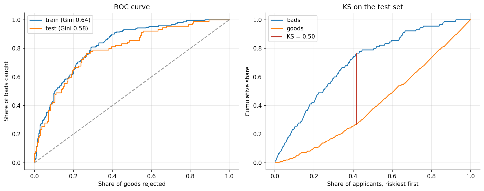
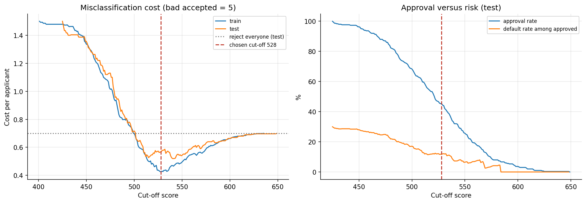
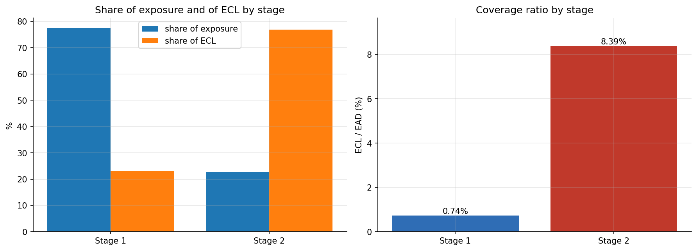

# Credit scorecard and IFRS 9 expected credit loss

An application scorecard built on the German Credit data (decoded with the corrected code table), followed by an expected credit loss (ECL) calculation in the style of IFRS 9, adopted in Indonesia as PSAK 109 (formerly PSAK 71). The notebook follows the path a bank's credit risk team takes with a new scorecard: binning and weight of evidence, a logistic regression scorecard, validation, a cost-based cut-off, and staged ECL with lifetime PD and macro scenarios.

[](https://colab.research.google.com/github/naufalabdul11/credit-scorecard-ecl/blob/main/notebooks/credit_scorecard_ecl.ipynb)

## Results

| | Value |
|---|---|
| Characteristics in the scorecard | 10 |
| Gini, train / test | 0.644 / 0.583 |
| KS, test | 0.500 |
| Hosmer-Lemeshow p-value, test | 0.819 |
| Score PSI, train vs test | 0.031 |
| Cut-off (lowest misclassification cost on train) | 528 points |
| Approval rate / default rate of approved, test | 45.3% / 11.8% (30.0% without the scorecard) |
| ECL on the 1,000-loan portfolio | DM 42,963, or 2.46% of exposure |
| Stage 2 share of exposure / of ECL | 22.6% / 76.8% |



The test Gini of 0.58 is in the range usually expected from application scorecards, and the gap to the training Gini is small. Predicted and observed default rates line up by decile, and the score distribution hardly moves between the two samples.

The data comes with a cost matrix: approving a borrower who defaults costs five times as much as rejecting one who would have repaid. The cheapest cut-off on the training data is 528. In theory the break-even point is good:bad odds of 5:1, which this score scale puts at 534, so the search and the theory agree. On the test set that cut-off approves 45% of applicants and brings the default rate of the approved book down from 30% to 12%.



For ECL, the model PDs are rescaled to a 5% average, loans are staged with a simple SICR proxy, and exposures follow an amortization schedule. Stage 2 is 23% of the exposure but carries 77% of the allowance, mostly because its loans have far higher PDs (about 19% against 2.6% in Stage 1).



## Method

1. Binning. A shallow decision tree proposes cut points for numeric characteristics (at most five bins, each with at least 5% of borrowers). Adjacent bins are merged until the default rate is monotonic. Small categories are merged into the category with the closest default rate.
2. WoE and IV. WoE = ln(%good / %bad), with 0.5 smoothing for sparse bins. Information value ranks the characteristics.
3. Selection. IV of at least 0.02, WoE correlation below 0.6, then backward elimination on coefficient sign and p-value. Sex/marital status and foreign-worker status are left out for fair-lending reasons.
4. Scorecard. Logistic regression on the WoE values, scaled to 600 points at 50:1 odds, with 20 points to double the odds.
5. Validation. Gini, KS, Hosmer-Lemeshow by decile, and PSI of the score.
6. Cut-off. Minimum expected cost on the training set, checked on the test set and against the theoretical break-even score.
7. ECL. PDs calibrated to a 5% average 12-month PD, lifetime PD from a constant monthly hazard, annuity exposure at a 10% effective rate, 45% LGD, three probability-weighted scenarios (upside, base, downside), discounting at the effective rate. Stage 1 gets 12-month ECL, Stage 2 lifetime ECL.

## Repository layout

```
credit-scorecard-ecl/
├── data/
│   └── german_credit.csv            UCI data with readable labels, default = 1
├── notebooks/
│   └── credit_scorecard_ecl.ipynb   the full analysis, with outputs
├── outputs/
│   ├── scorecard.csv                points for every bin
│   ├── ecl_by_stage.csv
│   ├── ecl_loan_level.csv
│   └── figures/
├── requirements.txt
└── README.md
```

## How to run

In Google Colab, click the badge above. All the libraries are preinstalled, and if `data/german_credit.csv` is missing the notebook downloads the raw file from UCI and decodes it.

Locally:

```bash
pip install -r requirements.txt
jupyter notebook notebooks/credit_scorecard_ecl.ipynb
```

The notebook was tested with pandas 2.2 and 3.0. All the ECL assumptions sit in the `ECL_CONFIG` cell, so the average PD, LGD, SICR rule or scenario weights can be changed and rerun.

## Data

The Statlog German Credit data (Hofmann, 1994; UCI Machine Learning Repository, CC BY 4.0) covers 1,000 consumer credits granted between 1973 and 1975 by a large regional bank in southern Germany, with 20 characteristics and 300 bad credits (Grömping, 2019).

The code table published with the UCI data has the levels of several attributes mixed up, and copies of the data that rely on it carry the wrong labels. For example, applicants with no checking account show up as "< 0 DM", and the foreign-worker flag is reversed. `data/german_credit.csv` is the raw `german.data` file decoded with the corrected table from Grömping (2019), and the notebook checks the decoding against Table 1 of that report before doing anything else.

Two other facts from the same report shape the analysis. Bad credits are heavily oversampled: the bank's real share was around 5%, which is the PD level used for ECL. The credit amounts went through an unknown monotonic transformation, so they rank borrowers correctly, but the DM totals in the ECL section are illustrative and the coverage ratios are what matter.

## Limitations

The data is fifty years old and comes from one German bank, so the scorecard is a demonstration of the method, not a model for a current loan book. It was validated on one random split rather than out of time. Outcomes exist only for approved borrowers, which is the likeliest reason a few characteristics run against intuition (home owners and real-estate holders default more often than renters and people without property). In the ECL part, LGD, the SICR rule, the scenario weights and the amortization profile are stated assumptions. The last section of the notebook lists what I would change with real portfolio data.

## References

- Hofmann, H. (1994). Statlog (German Credit Data) [Dataset]. UCI Machine Learning Repository. https://doi.org/10.24432/C5NC77
- Grömping, U. (2019). *South German Credit Data: Correcting a Widely Used Data Set*. Report 4/2019, Reports in Mathematics, Physics and Chemistry, Department II, Beuth University of Applied Sciences Berlin. Corrected data on UCI as South German Credit: https://doi.org/10.24432/C5X89F
- Siddiqi, N. (2017). *Intelligent Credit Scoring: Building and Implementing Better Credit Risk Scorecards* (2nd ed.). Wiley.
- IFRS Foundation. *IFRS 9 Financial Instruments*.
- Ikatan Akuntan Indonesia. *PSAK 109 Instrumen Keuangan* (formerly PSAK 71).
